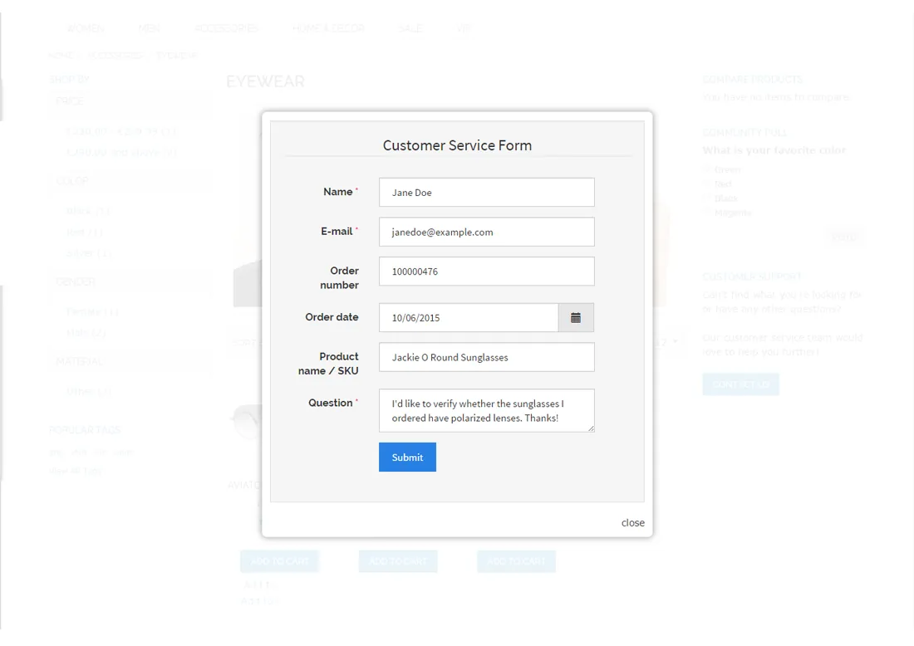
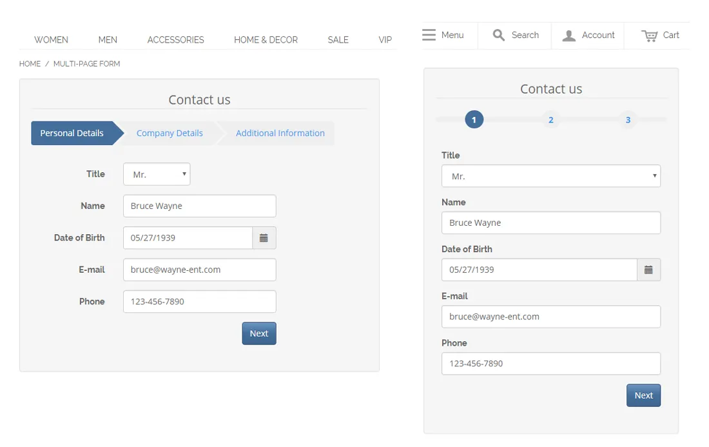
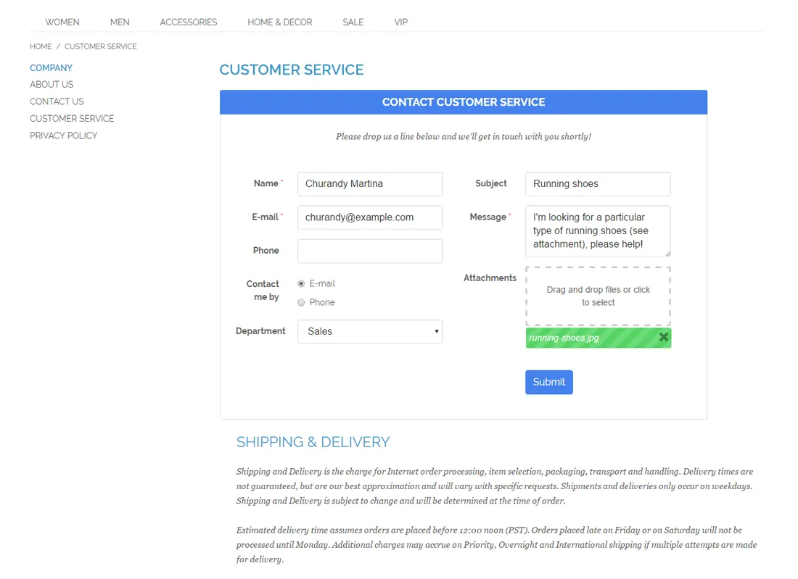
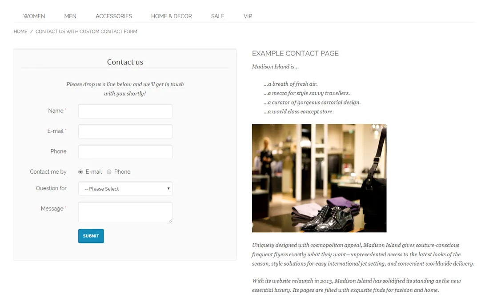

# Custom Contact Forms for Magento 1 / OpenMage

**Drag-and-drop contact form builder for Magento 1.**


Build contact forms in the Magento admin with a drag-and-drop form builder, a wide range of form fields, 18 front-end themes and many display options.

Includes customizable e-mail notifications, widgets to embed forms anywhere and management of form submissions in the admin, with CSV and Excel export.

> [!NOTE]
> Custom Contact Forms is free and open source under the MIT License (since 2026). Plugin Company no longer actively develops this extension, but issues and pull requests are welcome.
>
> The latest code commit on `main` fixes a security issue in earlier versions; release tag `1.21.2` is the original release. See [CHANGELOG.md](CHANGELOG.md).

## Features

### Front-end features

- 18 Bootstrap themes and many design options
- Responsive, AJAX-based front-end forms
- Form validation with Google reCAPTCHA or visual captcha
- Pop-up forms with optional exit intent
- Slide-out forms
- Multi-page and multi-column forms
- Conditional form fields for dynamic forms
- Pre-fill fields with customer, product and store data

### Admin features

- Drag-and-drop form builder
- Wide choice of form fields, including file upload
- Optional front-end page (URL) per form
- Embed forms in CMS pages, blocks and layouts with widgets
- Customizable customer and admin e-mail notifications
- Conditional admin notification recipients
- Save, manage and export form submissions in the admin

## Screenshots

<table>
  <tr>
    <td width="50%" valign="top"><br><sub>Pop-up contact form</sub></td>
    <td width="50%" valign="top"><br><sub>Pop-up form sidebar block</sub></td>
  </tr>
  <tr>
    <td width="50%" valign="top"><br><sub>Multi-page contact form</sub></td>
    <td width="50%" valign="top"><br><sub>Multi-column contact form</sub></td>
  </tr>
  <tr>
    <td width="50%" valign="top"><br><sub>Prefilled Product Questions form</sub></td>
    <td width="50%" valign="top"><br><sub>Contact form embedded in CMS page</sub></td>
  </tr>
</table>

More screenshots are on the [product page](https://plugin.company/magento1-extensions/custom-contact-forms.html).

## Compatibility

- **Magento:** Community Edition 1.4.x – 1.9.x, Enterprise Edition 1.8.x – 1.14.x
- **Latest version:** 1.21.2 (released 2020-04-06)
- **Composer package:** `plugincompany/magento1-custom-contact-forms`
- **Module:** `Plugincompany_Contactforms`

## Installation

### modman

```bash
cd /path/to/magento
modman init   # once per Magento installation
modman clone https://github.com/PluginCompany/magento1-custom-contact-forms.git
```

modman creates symlinks, so enable *Allow Symlinks* under System > Configuration > Advanced > Developer > Template Settings.

### Composer

With [magento-hackathon/magento-composer-installer](https://github.com/Cotya/magento-composer-installer) (it reads the `modman` file of this repository):

```bash
composer config repositories.plugin.company composer https://plugin.company/
composer require plugincompany/magento1-custom-contact-forms
```

Your project `composer.json` needs the Magento root directory in its `extra` section (and, with Composer 2.2+, the installer plugin allowed), for example:

```json
{
    "extra": { "magento-root-dir": "./" },
    "config": { "allow-plugins": { "magento-hackathon/magento-composer-installer": true } }
}
```

### Manual installation

Download the ZIP of the latest release from the [tags page](https://github.com/PluginCompany/magento1-custom-contact-forms/tags) ([1.21.2](https://github.com/PluginCompany/magento1-custom-contact-forms/archive/refs/tags/1.21.2.zip)) and copy the `app/`, `js/`, `lib/`, `media/` folders into your Magento root:

```bash
unzip magento1-custom-contact-forms-1.21.2.zip
cp -R magento1-custom-contact-forms-1.21.2/app magento1-custom-contact-forms-1.21.2/js magento1-custom-contact-forms-1.21.2/lib magento1-custom-contact-forms-1.21.2/media /path/to/magento/
```

Step-by-step instructions are in the [installation guide](docs/02-installing-the-magento-extension.md).

### After installing

Clear the cache (System > Cache Management, or `rm -rf var/cache/*`), then log out of the admin and log in again so the new configuration sections and permissions are loaded.

> [!NOTE]
> Some files of this extension are also shipped by other Plugin Company Magento 1 extensions: `js/plugincompany/codemirror` (also in magento1-syntax-highlighter); `js/plugincompany/jquerynoconflict.js` (also in 8 other extensions); `js/plugincompany/lib/animate.min.css` (also in magento1-newsletter-popup); `js/plugincompany/lib/jscolor` (also in magento1-newsletter-popup). The original ZIP packages simply overwrote each other's copy; with modman or the Composer installer the second extension reports an existing target for these paths.

### Upgrading from a purchased copy

Replace the old files with this release. No license key is needed; your settings and data stay as they are.

## Documentation

- [Documentation in this repository](docs/README.md) (Installation Guide, User Manual, Tutorials, Extension FAQ)
- Online documentation: <https://plugin.company/knowledge-base/docs/magento-custom-contact-forms/>
- Product page: <https://plugin.company/magento1-extensions/custom-contact-forms.html>
- Magento 2 version: [magento2-custom-contact-forms](https://github.com/PluginCompany/magento2-custom-contact-forms)

## Changelog

See [CHANGELOG.md](CHANGELOG.md) for the release history.

## Contributing

Found a bug or have an improvement? Please open an [issue](https://github.com/PluginCompany/magento1-custom-contact-forms/issues) or send a [pull request](https://github.com/PluginCompany/magento1-custom-contact-forms/pulls). Since the extension is no longer actively developed by Plugin Company, fixes from the community are the best way to keep it working on current Magento 1 / OpenMage and PHP versions.

## License

Plugin Company's code in this repository is released under the [MIT License](LICENSE), Copyright (c) 2014-2026 Plugin Company.

Bundled third-party libraries keep their own licenses; see [THIRD-PARTY-NOTICES.md](THIRD-PARTY-NOTICES.md) for the full list.

In particular:

- **jscolor 1.4.4** (`js/plugincompany/lib/jscolor/`) is licensed under **LGPL** (GNU Lesser General Public License, version not stated), not MIT.
- A few files are copies or adaptations of Magento core code and keep their original Magento license headers (OSL-3.0 / AFL-3.0).
- The license of some bundled files could not be determined or verified (Fontello-generated icon font "pccontact", Formstone, iframe position:fixed polyfill).
