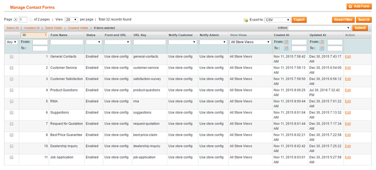

# Creating a Custom Contact Form

Navigate to **CMS > Contact Forms > Manage Contact Forms** in the top Admin Panel menu to create and manage your custom contact forms.

Create a new form by clicking the 'Add Form' button in the top right corner of the page.

Use the following tabs of the form view menu to create and configure your contact form:

- [Form Settings](./06-form-settings.md)
- [Form Builder](./07-form-builder.md)
- [Conditional Form Fields](./08-conditional-form-fields.md)
- [Front-end Style](./09-frontend-style.md)
- [Custom Javascript](./10-custom-javascript.md)
- [Customer Notification](./11-customer-notification.md)
- [Admin Notification](./12-admin-notification.md)
- [Form Submissions](./13-form-submissions.md)
- Store Views (for multi-store setup)

---

[Documentation index](./README.md) · [README](../README.md) · [Online version](https://plugin.company/knowledge-base/docs/magento-custom-contact-forms/user-manual/creating-a-custom-contact-form/)
