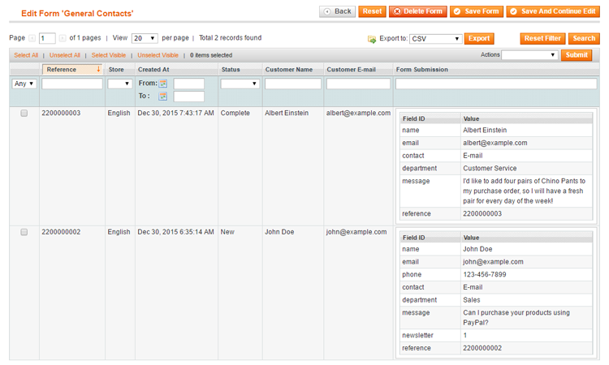
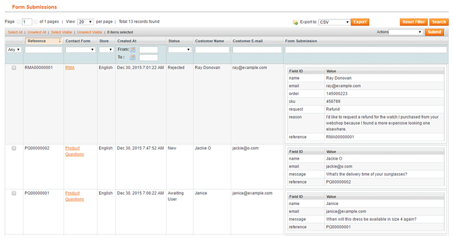
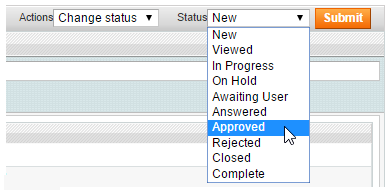
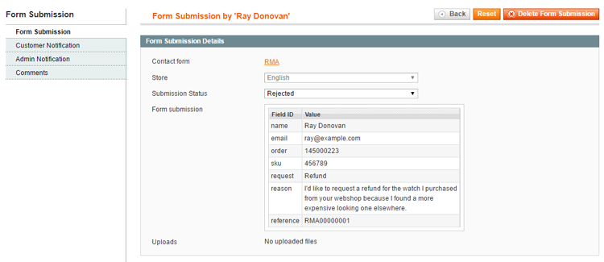
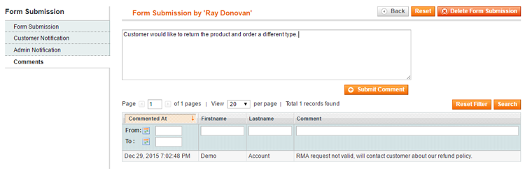

# Form Submissions

For each contact form you can choose to save its form submissions in the Admin Panel by enabling the 'Save form submissions' option in the [Form Settings](./06-form-settings.md) tab.

Every time a contact form is submitted, the form submission will be automatically saved in the back-end, where you can easily view its details and export submitted form data to CSV or Excel.

The forms submissions of a specific contact form can be managed in the Form Submissions tab of the form view.

Alternatively, you can manage the form submissions of all your contact forms by navigating to **CMS > Contact Forms > Form Submissions**.

You can modify the status of multiple form submissions at once using the 'Actions' dropdown menu in the top right corner of the Form Submissions page.

Select a form submission from the grid to view the submitted form data and copies of its customer and admin notification (if enabled).

You can optionally add form submission remarks for admin reference in the Comments tab. Tick the 'Send copy to customer' box to notify the customer about the comment by e-mail.

The form submission is automatically saved when changing its status or when submitting comments.

---

[Documentation index](./README.md) · [README](../README.md) · [Online version](https://plugin.company/knowledge-base/docs/magento-custom-contact-forms/user-manual/form-submissions/)
