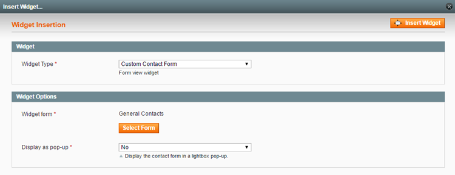
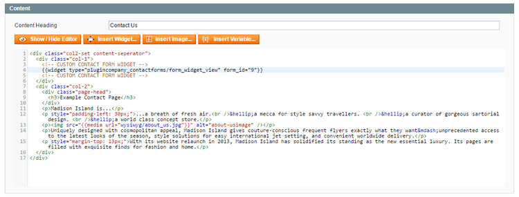
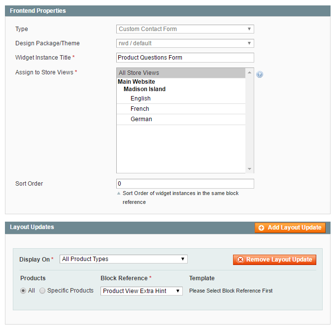

# Creating Custom Contact Form Widgets

Contact forms can be inserted anywhere in your Magento store by creating a custom contact form widget.

The contact form widget can be easily inserted in CMS pages or blocks or displayed in specific layout updates as further explained below.

The widget can be also used to create a [pop-up form](./15-widget-options.md#pop-up-widget), [exit intent form](./15-widget-options.md#exit-intent-widget) and [slide-out form](./15-widget-options.md#slide-out-widget).

## Adding Contact Forms to CMS Pages and Blocks

If you want to add one or multiple contact forms to a CMS page or block, you can insert the form using a widget by clicking the 'Insert Widget' button above the CMS content editor.

Select the widget type 'Custom Contact Form' and click 'Select Form' to choose a contact form.

Click the 'Insert Widget' button to [embed the form in a CMS page or block](./16-custom-contact-form-frontend-examples.md#embedded-form).

This will add a widget code snippet to the content editor, which can be moved to any desired place in the page or block content to move the contact form.

## Adding Contact Forms to Layout Updates

If you want to add a contact form to a specific section of a page layout, such as a sidebar, footer or [product page block](./16-custom-contact-form-frontend-examples.md#layout-form), you can create a widget using the **CMS > Widgets** interface by clicking the 'Add New Widget Instance' button in the top right corner of the page.

Select the widget type 'Custom Contact Form' and your store's 'Design Package / Theme' and click 'Continue'.

In the Frontend Properties tab, enter a 'Widget Instance Title' for admin reference and select the applicable store views.

Specify where you'd like to display the form in the Layout Updates section at the bottom of the Frontend Properties tab.

Select a custom contact form in the [Widget Options](./15-widget-options.md) tab, where you can also optionally configure the pop-up display options.

Save the widget and **refresh the cache** to add the contact form to the specified layout update in your front-end store.

---

[Documentation index](./README.md) · [README](../README.md) · [Online version](https://plugin.company/knowledge-base/docs/magento-custom-contact-forms/user-manual/creating-custom-contact-form-widgets/)
