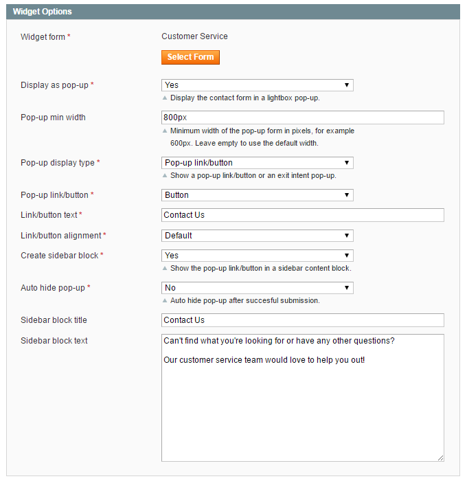
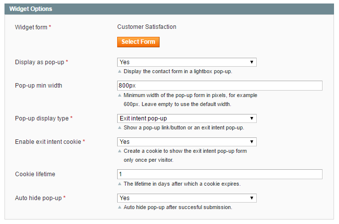
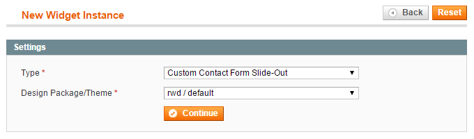
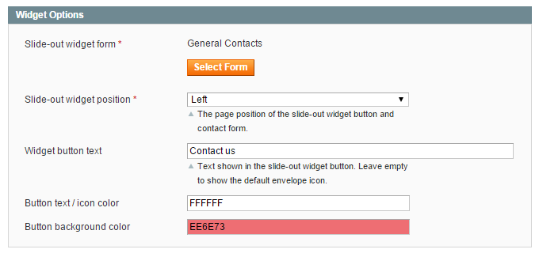

# Widget Options

When creating a contact form widget you can configure the front-end display options in the Widget Options section / tab as further explained below.

## Creating a Pop-up Contact Form

To create a [pop-up form](./16-custom-contact-form-frontend-examples.md#pop-up-form), follow the instructions for [creating a custom contact form widget](./14-creating-custom-contact-form-widgets.md) and enable the 'Display as pop-up' option in the Widget Options section or tab.

Select the display type 'Pop-up link/button' if you want to show the pop-up form by clicking a customizable front-end link or button.

If you'd like to display the pop-up link/button in a sidebar, you can optionally create a [sidebar block](./16-custom-contact-form-frontend-examples.md#sidebar-widget) and customize its title and content.

Alternatively you can add the pop-up link or button to [CMS pages or blocks](./14-creating-custom-contact-form-widgets.md#embedded-widget) or specific [layout updates](./14-creating-custom-contact-form-widgets.md#layout-widget).

## Creating an Exit Intent Pop-up Form

Select the display type 'Exit intent pop-up' in the Widget Options section or tab to show the pop-up form dynamically when a visitor intends to close a store page, i.e. when moving the cursor outside of the upper page boundary.

Enable the exit intent cookie to prevent the pop-up from reappearing to the same visitor.

The cookie lifetime defines after how many days the exit intent cookie expires, which by default is set to 1 day.

The exit intent pop-up form can be added to [CMS pages or blocks](./14-creating-custom-contact-form-widgets.md#embedded-widget) or specific [layout updates](./14-creating-custom-contact-form-widgets.md#layout-widget).

## Creating a Slide-out Contact Form

The Custom Contact Forms extension also includes a slide-out form widget, adding a button to the side of the front-end store from where the contact form appears when clicked on.

To create a [slide-out contact form](./16-custom-contact-form-frontend-examples.md#slide-out-form), follow the follow the instructions for [creating a custom contact form widget](./14-creating-custom-contact-form-widgets.md), but select the widget type 'Custom Contact Form Slide-Out'.

In the Widget Options tab you can choose a contact form and configure the position of the slide-out form widget.

Besides that you can customize the slide-out button text and colors.

---

[Documentation index](./README.md) · [README](../README.md) · [Online version](https://plugin.company/knowledge-base/docs/magento-custom-contact-forms/user-manual/widget-options/)
