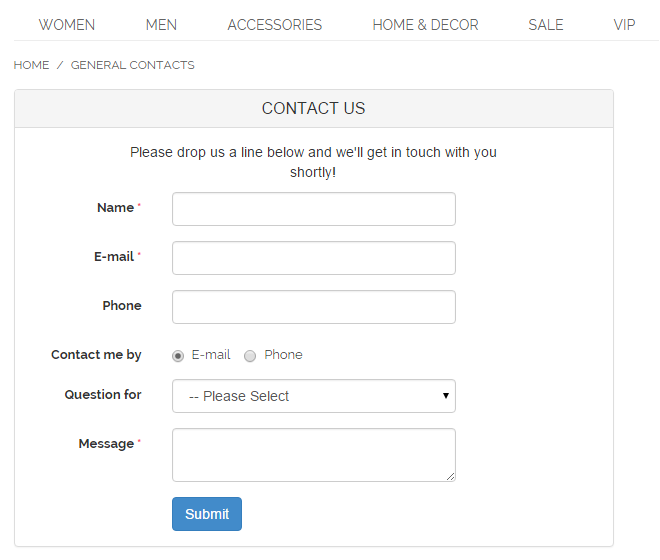
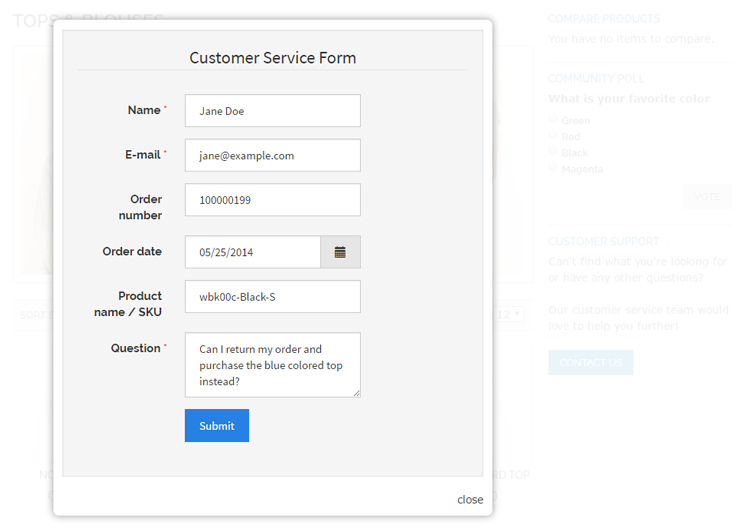
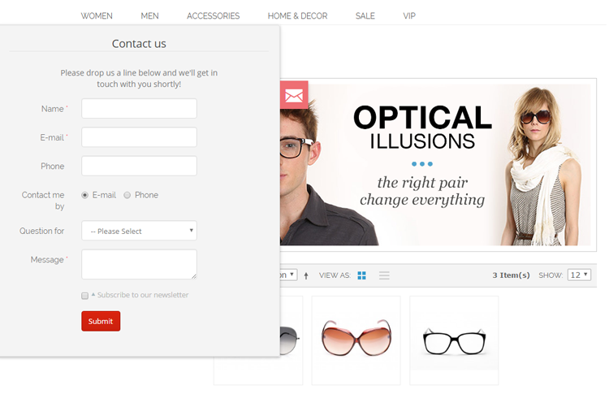
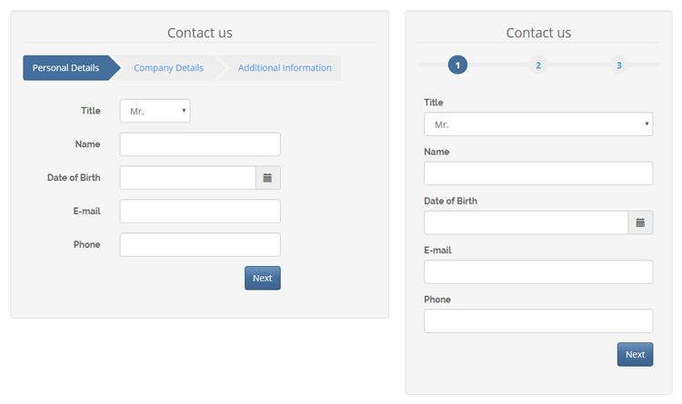
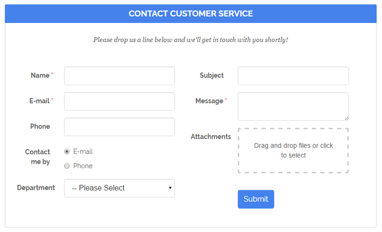

# Custom Contact Form Front-end Examples

Below you'll find front-end examples of the various contact forms display options.

## Contact Form Page

Example of custom contact form in an automatically created form page with breadcrumbs navigation.

## Contact Form Embedded in CMS Page

Example of custom contact form embedded in a CMS page using the [contact form widget](./14-creating-custom-contact-form-widgets.md#embedded-widget).

## Contact Form Embedded in Product Page

Example of a product questions form embedded in a product page by adding the contact form widget to a [specific layout update](./14-creating-custom-contact-form-widgets.md#layout-widget).

## Contact Form Sidebar Widget

Example of a [sidebar widget](./15-widget-options.md#pop-up-widget) with contact button, which displays the contact form in a light-box pop-up when clicked on.

## Pop-up Contact Form

Example of custom contact form shown in a light-box pop-up using the [pop-up form widget](./15-widget-options.md#pop-up-widget).

## Slide-out Contact Form

Example of the a form appearing from the left side of the front-end store using a [slide-out form widget](./15-widget-options.md#slide-out-widget).

## Multi-page Contact Form

Example of multi-page contact form, which is divided into multiple pages or tabs with the [Form Page](./07-form-builder.md#form-page) component. The top navigation bar automatically adjusts to smaller resolution screens if the form page titles don't fit on one line.

## Multi-column Contact Form

Example of multi-column contact form, which is divided into multiple sections and columns using the [Form Section](./07-form-builder.md#form-section) component.

---

[Documentation index](./README.md) · [README](../README.md) · [Online version](https://plugin.company/knowledge-base/docs/magento-custom-contact-forms/user-manual/custom-contact-form-frontend-examples/)
