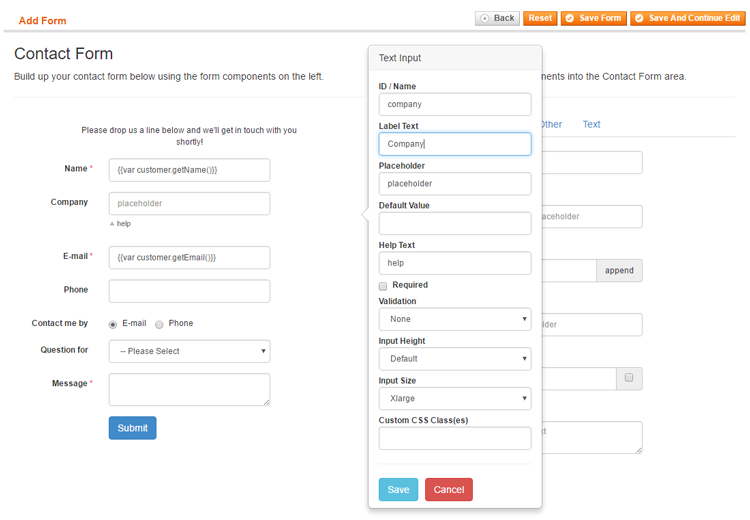

# Adding Custom Variables to E-mail Notifications

The Custom Contact Forms e-mail notifications support the use of custom variables, allowing you to automatically add any submitted form data to your customer and admin notifications.

When creating a contact form using the [Form Builder](./07-form-builder.md), you can configure the content and settings of each form component in a pop-over. The unique **ID / Name** which needs to be assigned to each form component of your contact form can be used as a custom variable by simply inserting the ID wrapped in brackets in the e-mail notification content, for example `{name}`, `{email}`, `{phone}`, etc.

In the Form Builder example above, the ID 'company' is assigned to the Company input field. By adding the variable `{company}` to the e-mail notification content, the submitted company name entered in this input field will be automatically added to the customer and or admin e-mail notification.

Alternatively, you can use the variable `{submission_overview}` to include all submitted form data in your admin notifications, including the front-end URL on which the form was submitted and the visitor's IP address. The URL and IP address can also be added to the e-mail separately using the variables `{form_url}` and `{visitor_ip}`.

---

[Documentation index](./README.md) · [README](../README.md) · [Online version](https://plugin.company/knowledge-base/docs/magento-custom-contact-forms/tutorials/adding-custom-variables-to-email-notifications/)
