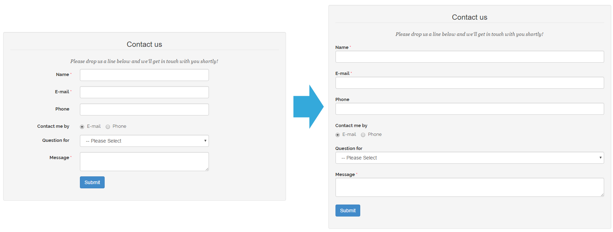
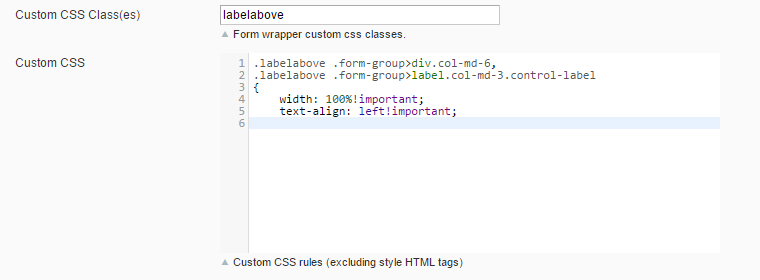

# Placing Labels Above Form Fields

Using our Custom Contact Forms extension for Magento, it's possible to display the form field labels above the fields by using some custom CSS.



## Step 1: Open the Front-end Style Tab

Navigate to your contact form and click on the "Front-end Style" tab.

## Step 2: Add a CSS Class

Add the value "labelabove" in the "Custom CSS Class(es)" field.

## Step 3: Add the CSS

Add the following CSS snippet to the "Custom CSS" field:

```css
.labelabove .form-group>div.col-md-6,
.labelabove .form-group>label.col-md-3.control-label
{
    width: 100%!important;
    text-align: left!important;
}
```



## Step 4: Save the Form

Save the form and check the result in the storefront.

---

[Documentation index](./README.md) · [README](../README.md) · [Online version](https://plugin.company/knowledge-base/docs/magento-custom-contact-forms/tutorials/placing-labels-above-form-fields/)
